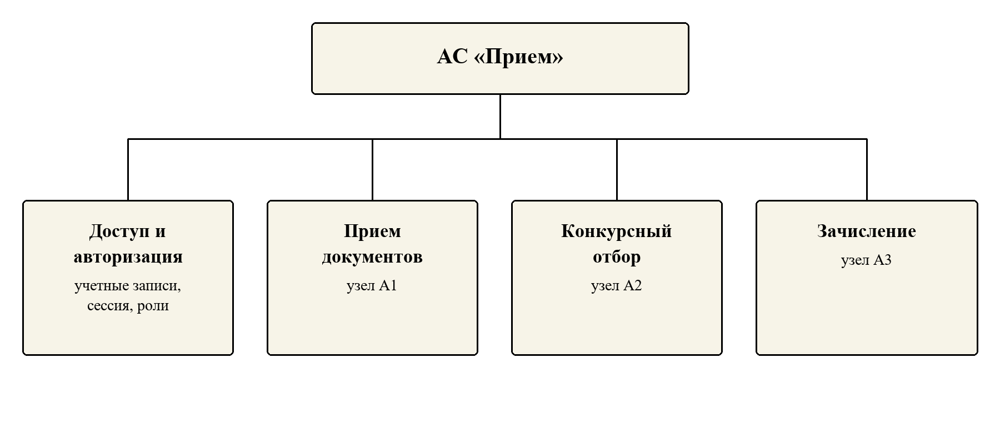
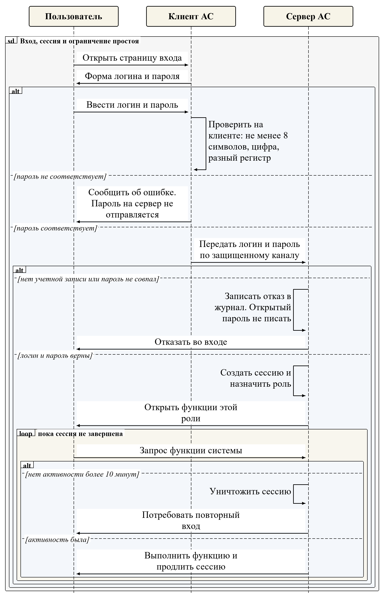
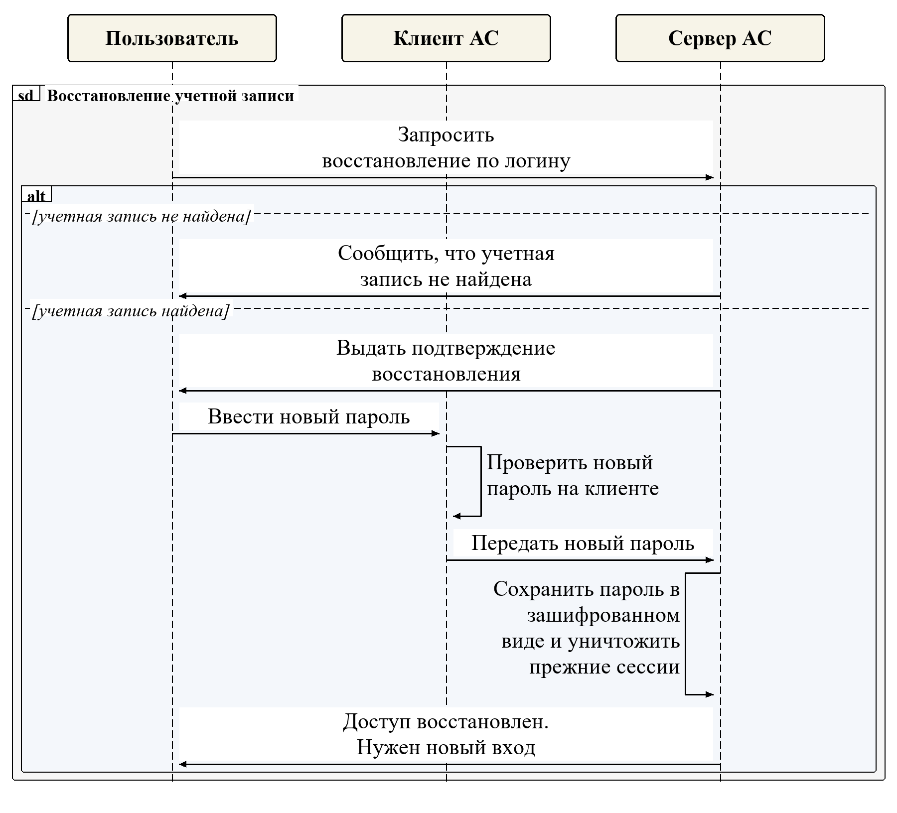
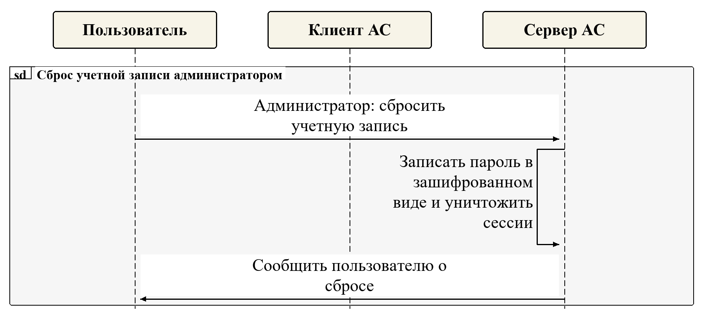

# Лабораторная работа № 4. Разработка технических требований

Оформленный отчёт: `ЛР4_отчет.docx`.

**Наименование работы:** разработка технических требований на создание автоматизированной системы приема абитуриентов (АС «Прием») в соответствии с СТП 09150.11.118-2009. Требования прослежены к функциональной модели IDEF0 «Принять абитуриентов».

**Вариант задания:** прием абитуриентов в учреждение образования.

**Автор:** Кравченко А.С.

## Содержание

1. Введение
2. Общие сведения
3. Назначение и цели создания
4. Характеристика объектов системы
5. Требования к системе
6. Требования к видам обеспечения
7. Состав и содержание работ
8. Порядок приемки в эксплуатацию
9. Требования к документированию
10. Приложение А. Диаграмма аутентификации и авторизации
11. Приложение Б. Матрица прослеживаемости

## 1. Введение

1.1 Настоящие технические требования определяют цели создания, состав функций, исходные данные и порядок создания автоматизированной системы приема абитуриентов (далее — АС «Прием»).

1.2 Технические требования являются основным документом, по которому разрабатывают и принимают АС «Прием». Структура документа соответствует СТП 09150.11.118-2009.

1.3 Каждое требование имеет уникальный идентификатор вида REQ-…, сформулировано так, чтобы его можно было проверить, и связано с узлом или стрелкой функциональной модели IDEF0 процесса «Принять абитуриентов». Словарь стрелок и состав узлов этой модели являются источником бизнес-процессов, входов, выходов, нормативной базы, ролей и смежных систем.

1.4 В состав АС «Прием» входит обязательная подсистема доступа и авторизации. Процесс аутентификации и авторизации задан диаграммой последовательности на рисунках 2–4.

1.5 Термины модели IDEF0 используются в значениях раздела 2 и таблицы 3. Иные толкования тех же слов в требованиях не применяются.

## 2. Общие сведения

### 2.1. Наименование работы

Разработка технических требований на автоматизированную систему приема абитуриентов (АС «Прием»).

### 2.2. Заказчик и ответственный по проекту

Заказчик — учреждение образования «Белорусский государственный университет транспорта».

Ответственный по проекту со стороны заказчика — председатель приемной комиссии.

### 2.3. Организация-пользователь

Учреждение образования «Белорусский государственный университет транспорта», приемная комиссия.

### 2.4. Объект внедрения

Приемная комиссия Белорусского государственного университета транспорта.

### 2.5. Основание для разработки

Основание для состава функций — функциональная модель IDEF0 «Принять абитуриентов»: контекстная диаграмма A-0 и декомпозиции A0, A1, A2, A3.

Основание для структуры настоящего документа — СТП 09150.11.118-2009.

Основание для подсистемы доступа и авторизации — обязательные условия этой подсистемы: вход по логину и паролю, состав пароля, проверка пароля на стороне клиента, хранение пароля в зашифрованном виде, уничтожение сессии при простое более 10 минут, сброс и восстановление учетной записи, диаграмма процесса.

### 2.6. Термины, определения и сокращения

В настоящих технических требованиях применены термины:

**Абитуриент** — лицо, подавшее заявление о допуске к конкурсу.

**Заявление** — письменное обращение абитуриента: фамилия, имя, отчество, избранная специальность, форма обучения, контактные данные.

**Аттестат** — документ об общем среднем образовании: учебное заведение, год окончания, предметы и оценки.

**Сертификат ЦТ** — документ о результате централизованного тестирования: предмет, балл, год сдачи. Проведение тестирования в АС «Прием» не входит.

**Правила приема** — нормативный порядок приема: сроки, перечень документов, минимальные баллы, формула конкурсного балла, условия зачисления.

**План приема** — контрольные цифры приема по специальностям и формам обучения.

**Допуск к конкурсу** — состояние абитуриента, чей комплект документов проверен и который допущен к расчету конкурсного балла.

**Конкурсный балл** — балл, рассчитанный по правилам приема из аттестата и сертификатов ЦТ.

**Список зачисления** — перечень абитуриентов, рекомендованных к зачислению в пределах плана приема и остатка мест.

**Приказ о зачислении** — распорядительный документ: перечень зачисленных, специальности, основание зачисления. Статус изданного приказа документ получает после решения председателя приемной комиссии.

**Личное дело** — дело зачисленного: заявление, аттестат, сертификаты ЦТ и сведения приказа. Уведомление об отказе в личное дело не входит.

**Уведомление об отказе** — сообщение об отказе в зачислении по итогам конкурса с указанием причины.

**Запрос документов** — требование исправить или дополнить комплект. Запрос документов отказом в зачислении не является.

**Остаток мест** — число мест по специальности и форме обучения, оставшееся после зачисления.

**Учетная запись** — логин, зашифрованный пароль, роль и контакт для восстановления доступа.

**Сессия** — период подтвержденного доступа после успешного входа. Сессия уничтожается при выходе пользователя и при отсутствии активности более 10 минут.

**Пользователь АС** — лицо с учетной записью: администратор, секретарь приемной комиссии или председатель приемной комиссии. Абитуриент учетной записи в АС «Прием» не имеет: документы в систему вносит приемная комиссия.

Таблица 1 – Сокращения

| Сокращение | Значение |
| --- | --- |
| АС | автоматизированная система |
| АИС | автоматизированная информационная система |
| БелГУТ | Белорусский государственный университет транспорта |
| НСИ | нормативно-справочная информация |
| ТТ | технические требования |
| ЦТ | централизованное тестирование |
| СТП | стандарт предприятия |

## 3. Назначение и цели создания

### 3.1. Назначение

АС «Прием» предназначена для автоматизации приема абитуриентов в приемной комиссии БелГУТ. Система проводит заявление, аттестат и сертификаты ЦТ по цепочке модели IDEF0 до трех результатов: приказа о зачислении, личного дела и уведомления об отказе.

Система обеспечивает доступ работников комиссии и администратора по учетным записям. Абитуриент взаимодействует с комиссией. Отдельный кабинет абитуриента настоящими требованиями не задается: на модели IDEF0 абитуриент не является механизмом процесса.

### 3.2. Цели создания

Цели создания АС «Прием»:

- сохранить одну цепочку объектов от принятого заявления до приказа и личного дела и не вводить уже сохраненные сведения повторно;
- рассчитывать конкурсный балл и список зачисления по действующим правилам приема и плану приема;
- издавать приказ только по проверенному списку и после решения председателя приемной комиссии;
- формировать уведомление об отказе только по итогам конкурса;
- разграничить функции администратора, секретаря и председателя и защитить учетные записи.

Достижение целей проверяется требованиями раздела 5 и матрицей приложения Б.

## 4. Характеристика объектов системы

### 4.1. Объект автоматизации и границы

Объект автоматизации — прием абитуриентов приемной комиссией БелГУТ. Точка зрения, с которой заданы функции, — председатель приемной комиссии.

Граница автоматизации совпадает с границей модели A-0. Внутри границы: прием заявления и учебных документов, конкурс, зачисление. За границей и в АС «Прием» не автоматизируются: проведение централизованного тестирования, обучение после зачисления, разработка правил приема, финансовая деятельность учреждения.

Правила приема и план приема поступают извне как управление. Сертификаты ЦТ поступают извне как вход. АС «Прием» хранит их и применяет. Она не заменяет источник этих сведений.

### 4.2. Бизнес-процессы

Главная функция модели — принять абитуриентов (диаграмма A-0, узел 0). На диаграмме A0 она разложена на три работы. Каждая работа разложена еще на три блока.

Таблица 2 – Узлы модели IDEF0, принятые как состав функций АС «Прием»

| Узел | Работа | Состав |
| --- | --- | --- |
| A-0 | Принять абитуриентов | Контекст: один блок, граница процесса |
| A0 | Принять абитуриентов | A1 принять документы; A2 провести конкурс; A3 зачислить абитуриентов |
| A1 | Принять документы | Принять заявление; принять учебные документы; оформить допуск |
| A2 | Провести конкурс | Рассчитать конкурсный балл; ранжировать абитуриентов; сформировать список зачисления |
| A3 | Зачислить абитуриентов | Сверить список зачисления; издать приказ о зачислении; оформить личные дела |

На A0 результат A1 «Допуск к конкурсу» является входом A2. Результат A2 «Список зачисления» является входом A3. Обратные связи A0: «Запрос документов» (A2 к A1) и «Остаток мест» (A3 к A2, сторона управления).

### 4.3. Входы, выходы, управление, механизмы и внутренние объекты

Таблица 3 – Словарь стрелок модели IDEF0

| Наименование | Тип | Где проявляется | Содержание |
| --- | --- | --- | --- |
| Заявление | Вход | A-0, A1 блок 1 | Обращение абитуриента о допуске к конкурсу |
| Аттестат | Вход | A-0, A1 блок 2 | Документ об общем среднем образовании |
| Сертификаты ЦТ | Вход | A-0, A1 блок 2 | Результаты ЦТ. Проведение ЦТ вне границы |
| Правила приема | Управление | A-0, A0, A1, A2, A3 | Порядок приема. В результат не преобразуются, а ограничивают работы |
| План приема | Управление | A-0, A0, A2, A3 | Контрольные цифры. На диаграмму A1 не переходит: в прием документов план не входит |
| Приказ о зачислении | Выход | A-0, A3 | Распорядительный документ. На A3 одновременно выходит за границу и передается на оформление личных дел |
| Личное дело | Выход | A-0, A3 блок 3 | Дело зачисленного |
| Уведомление об отказе | Выход | A-0, A2 | Отказ по итогам конкурса. На A1 этого выхода нет |
| Приемная комиссия | Механизм | A-0 и все декомпозиции | Работники, которые принимают документы, ведут конкурс и оформляют зачисление |
| АИС приема | Механизм | A-0 и все декомпозиции | Система, которую задают настоящие ТТ: АС «Прием» |
| Допуск к конкурсу | Внутренняя | A0: A1 к A2; выход A1; вход A2 | Комплект проверен, абитуриент допущен к расчету балла |
| Список зачисления | Внутренняя | A0: A2 к A3; выход A2; вход A3 | Рекомендованные к зачислению в пределах плана |
| Запрос документов | Внутренняя | A0: A2 к A1; выход блока расчета балла | Требование дополнить комплект, не отказ |
| Остаток мест | Внутренняя | A0: A3 к A2 как управление; выход A3 блок 3 | Ограничивает формирование списка |
| Принятое заявление | Внутренняя | A1: блок 1 к блоку 2 | Зарегистрированное заявление |
| Комплект документов | Внутренняя | A1: блок 2 к блоку 3 | Заявление, аттестат и сертификаты ЦТ |
| Замечания | Внутренняя | A1: блок 3 к блоку 1 | Недостатки комплекта, из-за которых допуск не оформлен |
| Конкурсные баллы | Внутренняя | A2: блок 1 к блоку 2 | Баллы по правилам приема |
| Рейтинг абитуриентов | Внутренняя | A2: блок 2 к блоку 3 | Допущенные, упорядоченные по убыванию балла |
| Корректировка рейтинга | Внутренняя | A2: блок 3 к блоку 2 | Уточнение рейтинга с учетом остатка мест и плана |
| Проверенный список | Внутренняя | A3: блок 1 к блоку 2 | Список, сверенный с планом и правилами |

### 4.4. Нормативная база

Управление процесса, выделенное из модели:

- правила приема в учреждение образования, включая сроки, перечень документов, минимальные баллы, формулу конкурсного балла и условия зачисления;
- план приема по специальностям и формам обучения.

Документы, относительно которых читаются правила приема и защита сведений:

- Кодекс Республики Беларусь об образовании — в части приема в учреждения образования;
- СТП 09150.11.118-2009 — в части состава настоящих технических требований;
- Закон Республики Беларусь «О защите персональных данных» — в части заявления, аттестата, сертификатов и учетных записей.

Правила приема и план приема хранятся в АС «Прием» как НСИ. Изменение НСИ не переписывает уже изданный приказ.

### 4.5. Роли

Таблица 4 – Роли

| Роль | Основание | Что делает в АС «Прием» |
| --- | --- | --- |
| Секретарь приемной комиссии | Механизм M1, операционная часть | Вводит заявление, аттестат и сертификаты, отрабатывает замечания и запрос документов, запускает расчет балла, рейтинг, проект списка и проект уведомления об отказе |
| Председатель приемной комиссии | Механизм M1, решения | Подтверждает допуск в спорном случае, утверждает список зачисления, фиксирует решение об издании приказа |
| Администратор | Ведение механизма M2 и подсистема доступа | Учетные записи, роли, сброс пароля, правила приема, план приема, резервное копирование |
| Абитуриент | Источник входов I1, I2, I3 | Подает документы комиссии. Учетной записи в АС «Прием» не получает |

Один человек может иметь только те функции, которые назначены его роли. Совмещение ролей на одной учетной записи не допускается: председателю и секретарю заводятся разные учетные записи.

### 4.6. Смежные системы и источники данных

На модели IDEF0 именованных внешних информационных систем нет. Смежные источники выделены по входам и управлению, которые приходят из-за границы, и по выходам, которые границу покидают.

Таблица 5 – Источники и потребители на границе модели

| Сведение или результат | Источник или потребитель | Что обязана делать АС «Прием» |
| --- | --- | --- |
| Заявление, аттестат | Абитуриент через приемную комиссию | Принять и сохранить при вводе секретарем |
| Сертификаты ЦТ | Абитуриент; происхождение результата — организация, проводящая ЦТ | Сохранить предмет, балл и год. Проведение ЦТ и обмен с внешней системой ЦТ не требуются |
| Правила приема, план приема | Руководство учреждения, утвердившее НСИ | Хранить как управление. Ввод и изменение — у администратора |
| Приказ о зачислении, личное дело | Дальнейший учет студентов, за границей модели | Сформировать документы. Обязательная выгрузка во внешнюю систему не требуется |
| Уведомление об отказе | Абитуриент, через комиссию | Сформировать текст с причиной по итогам конкурса |

Программный интерфейс для внешних систем настоящими требованиями не задается.

### 4.7. Входные и выходные данные и формы их представления

Входные и выходные данные должны быть идентифицируемы и должны иметь значения, которые система сохраняет и показывает без перекодирования вручную.

Таблица 6 – Форматы данных

| Объект | Поле | Формат |
| --- | --- | --- |
| Заявление | Фамилия, имя, отчество | Текст, до 150 знаков |
| Заявление | Специальность | Код и наименование, до 150 знаков |
| Заявление | Форма обучения | Значение справочника |
| Заявление | Контактные данные | Текст, до 100 знаков |
| Аттестат | Учебное заведение | Текст, до 200 знаков |
| Аттестат | Год окончания | Число из 4 знаков |
| Аттестат | Предмет и оценка | Текст до 80 знаков и число |
| Сертификат ЦТ | Предмет, балл, год | Текст до 80 знаков, число, число из 4 знаков |
| Конкурс | Конкурсный балл | Число |
| План приема | Специальность, форма, число мест | Справочник и целое число |
| Приказ | Номер, дата, перечень | Текст, дата, список лиц и специальностей |
| Уведомление об отказе | Абитуриент и причина | Текст |
| Личное дело | Состав | Связанные заявление, аттестат, сертификаты ЦТ, сведения приказа |
| Учетная запись | Логин | Уникальный текст |
| Учетная запись | Пароль | Зашифрованное значение. На вводе открытый пароль не короче 8 символов |
| Сессия | Последняя активность | Дата и время |

Таблица 7 – Выходные и промежуточные документы

| Документ | Когда формируется | Состав |
| --- | --- | --- |
| Принятое заявление | A1, блок 1 | Реквизиты заявления |
| Комплект документов | A1, блок 2 | Заявление, аттестат, сертификаты ЦТ |
| Замечания, запрос документов | A1 и A2, если комплект не позволяет идти дальше | Перечень недостающих или противоречивых сведений |
| Допуск к конкурсу | A1, блок 3, комплект полон | Ссылка на проверенный комплект |
| Конкурсные баллы, рейтинг | A2, блоки 1 и 2 | Балл и порядок по убыванию |
| Список зачисления | A2, блок 3 | Лица в пределах мест |
| Уведомление об отказе | A2 после конкурса | Причина отказа |
| Проверенный список | A3, блок 1 | Список после сверки с планом и правилами |
| Приказ о зачислении | A3, блок 2, после решения председателя | Реквизиты приказа и перечень |
| Личное дело | A3, блок 3 | Состав по таблице 6 |
| Остаток мест | A3, блок 3 | Места по специальности и форме |

### 4.8. Технологические операции, подлежащие автоматизации

Автоматизируются операции механизмов модели, которые выполняет АИС приема. Решение председателя остается действием человека и только фиксируется системой.

Операции приема документов (A1): регистрация заявления; учет аттестата и сертификатов ЦТ; проверка комплектности по правилам приема; замечания; запрос документов; оформление допуска.

Операции конкурса (A2): расчет конкурсного балла; ранжирование; корректировка рейтинга; формирование списка зачисления с учетом плана и остатка мест; уведомление об отказе.

Операции зачисления (A3): сверка списка; проект приказа; фиксация решения председателя; личное дело; расчет остатка мест.

Операции доступа, которых на диаграммах IDEF0 нет и которые обязательны для АС «Прием»: вход по логину и паролю; проверка пароля на клиенте; хранение пароля в зашифрованном виде; уничтожение сессии; сброс и восстановление учетной записи; журнал доступа.

## 5. Требования к системе

### 5.1. Требования к структуре

АС «Прием» состоит из четырех подсистем. Первая обязательна по условиям подсистемы доступа. Остальные повторяют узлы A1, A2 и A3.

Таблица 8 – Подсистемы

| Подсистема | Узел модели | Назначение |
| --- | --- | --- |
| Доступ и авторизация | Механизм M2, пользователи из M1 | Вход, роли, сессия, журнал, сброс и восстановление учетной записи |
| Прием документов | A1 | Заявление, учебные документы, замечания, допуск |
| Конкурсный отбор | A2 | Балл, рейтинг, список зачисления, уведомление об отказе, запрос документов |
| Зачисление | A3 | Сверка, приказ, личное дело, остаток мест |

Иерархия подсистем приведена на рисунке 1.

Подсистемы работают в одной базе данных АС «Прием». Отдельный обмен между подсистемами по внешней сети не требуется.

Режим работы в период приема документов, конкурса и зачисления — интерактивный: результат операции доступен в том же сеансе пользователя, без отложенной ночной обработки. Вне приемной кампании администратор ведет НСИ и учетные записи.

**REQ-NFR-03.** Расчет конкурсного балла одного допущенного абитуриента и сохранение зарегистрированного заявления завершаются в том же сеансе: пользователь видит сохраненный результат без отдельного пакетного запуска.

Проверка: после команды сохранения заявление находится поиском в этой же сессии; после команды расчета балл отображается у этой же карточки до выхода из сессии.

Прослеживаемость: 5.1 | A1, A2 | принятое заявление, конкурсные баллы

### 5.2. Требования к процедурам доступа к системе

Подсистема «Доступ и авторизация» выполняет аутентификацию, авторизацию, учет сессии, сброс и восстановление данных учетной записи. Диаграмма последовательности этого процесса приведена на рисунках 2–4.

**REQ-SEC-01.** Процесс аутентификации и авторизации должен осуществляться через запрос данных учетной записи (логин и пароль) пользователя. Функции приема документов, конкурса, зачисления и администрирования НСИ до успешного входа недоступны.

Проверка: открытие функций без входа блокируется; верная пара логина и пароля открывает только функции роли этой учетной записи.

Прослеживаемость: 5.2 | M1, M2 | учетная запись пользователя

**REQ-SEC-02.** Пароль пользователя должен быть не менее 8 символов и обязательно содержать цифры и символы разного регистра. Проверка пароля на соответствие требованиям выполняется на стороне клиента. Если пароль требованиям не соответствует, клиент сообщает об ошибке и не отправляет пароль на сервер.

Проверка: пароль короче 8 символов, пароль без цифры и пароль из символов одного регистра клиент не отправляет. Пароль из 8 и более символов, в котором есть цифра, прописная и строчная буквы, клиент отправляет на сервер.

Прослеживаемость: 5.2 | подсистема доступа | пароль, клиент АС

**REQ-SEC-03.** Хранение пароля пользователя в системе должно осуществляться в зашифрованном виде. Открытый пароль не записывается в базу данных, журнал доступа и резервную копию и не показывается в интерфейсе после сохранения.

Проверка: после успешной установки пароля поиск введенной открытой строки в базе, журнале и файле резервной копии ничего не находит. Экран учетной записи показывает, что пароль задан, и не показывает его текст.

Прослеживаемость: 5.2 | подсистема доступа | пароль учетной записи

**REQ-SEC-04.** При отсутствии активности пользователя в системе более 10 минут уничтожается сессия. Активностью считается запрос пользователя к АС «Прием». После уничтожения сессии функция выполняется только после нового входа по логину и паролю.

Проверка: запрос на 9-й минуте после предыдущего запроса выполняется и сдвигает момент активности. При отсутствии запросов более 10 минут следующий запрос функции отклоняется, а прежний идентификатор сессии не принимается.

Прослеживаемость: 5.2 | подсистема доступа | сессия

**REQ-SEC-05.** В АС «Прием» должна быть подсистема сброса и восстановления данных учетной записи пользователя. Восстановление выполняет сам пользователь: указывает логин, подтверждает запрос способом, заданным для учетной записи, и задает новый пароль. Новый пароль проходит проверку на стороне клиента и сохраняется в зашифрованном виде. Сброс выполняет администратор. И восстановление, и сброс уничтожают действующие сессии этой учетной записи.

Проверка: для существующего логина пользователь задает новый пароль и входит уже им, а старый пароль не подходит. Для неизвестного логина система сообщает, что учетная запись не найдена, и пароль не меняет. После сброса администратором прежняя сессия этой учетной записи недействительна.

Прослеживаемость: 5.2 | подсистема доступа | учетная запись, пароль, сессия

**REQ-SEC-06.** Система должна предоставлять три роли с разным составом функций. Администратор ведет учетные записи, выполняет сброс пароля, изменяет правила приема и план приема, запускает резервное копирование. Секретарь ведет прием документов, расчет, рейтинг, проект списка зачисления и проект уведомления об отказе. Председатель подтверждает допуск в спорном случае, утверждает список зачисления и фиксирует решение об издании приказа. Функция чужой роли пользователю недоступна.

Проверка: под каждой ролью вызываются функции своей роли и по одной функции чужой роли. Своя выполняется, чужая отклоняется.

Прослеживаемость: 5.2 | M1, M2 | роли приемной комиссии и администратора

**REQ-SEC-07.** Система должна вести журнал доступа: успешный вход, отказ во входе, выход, уничтожение сессии по истечении 10 минут, сброс и восстановление учетной записи. Запись журнала содержит момент времени, логин и вид события. Открытого пароля в журнале нет.

Проверка: каждый перечисленный вид события создает запись с логином и временем. Поиск открытого пароля по журналу пуст.

Прослеживаемость: 5.2 | подсистема доступа | журнал доступа

**REQ-SEC-08.** Сервер должен отклонять установку и смену пароля, если пароль короче 8 символов, не содержит цифру или не содержит символы разного регистра, в том числе когда запрос пришел в обход проверки на клиенте.

Проверка: прямой запрос к серверу с паролем «abcdefg» не меняет сохраненный пароль. Запрос с паролем, который соответствует требованиям, пароль меняет.

Прослеживаемость: 5.2 | подсистема доступа | пароль

### 5.3. Требования к функциональной безопасности

АС «Прием» не управляет технологическим процессом и не имеет уровня полноты безопасности. Здесь функциональная безопасность означает целостность приемной кампании: выход узла появляется только из допустимого входа и действующего управления, а результат, которого нет на модели, система не создает.

**REQ-A1-01.** Система должна регистрировать заявление: фамилию, имя, отчество, избранную специальность, форму обучения и контактные данные.

Проверка: сохраненное заявление открывается повторно и содержит все перечисленные поля.

Прослеживаемость: 5.3 | A1, блок 1 «Принять заявление» | I1 Заявление

**REQ-A1-02.** Система должна хранить аттестат: учебное заведение, год окончания, предметы и оценки.

Проверка: у абитуриента сохраняются учреждение, год и не менее одной пары «предмет — оценка», и эти значения читаются без повторного ввода.

Прослеживаемость: 5.3 | A1, блок 2 «Принять учебные документы» | I2 Аттестат

**REQ-A1-03.** Система должна хранить сертификаты ЦТ: предмет, балл и год сдачи. Функции проведения централизованного тестирования в системе нет.

Проверка: сертификат сохраняется этими тремя полями. В перечне функций нет операции проведения или оценивания ЦТ.

Прослеживаемость: 5.3 | A1, блок 2 | I3 Сертификаты ЦТ

**REQ-A1-04.** Система должна связывать заявление, аттестат и сертификаты ЦТ с одной карточкой абитуриента.

Проверка: по фамилии и имени открывается одна карточка, в которой видны заявление, аттестат и сертификаты этого лица.

Прослеживаемость: 5.3 | A1 | I1, I2, I3, комплект документов

**REQ-A1-05.** Система должна проверять комплект по правилам приема и не оформлять допуск к конкурсу, пока комплект не полон.

Проверка: карточка без аттестата не получает допуск. После ввода недостающего документа и повторной проверки допуск оформляется.

Прослеживаемость: 5.3 | A1, блок 3 «Оформить допуск» | C1 Правила приема, допуск к конкурсу

**REQ-A1-06.** При неполном или противоречивом комплекте система должна формировать замечания и запрос документов. Запрос документов не создает уведомление об отказе и не является отказом в зачислении.

Проверка: для неполного комплекта есть замечание с перечнем недостатков и запрос документов. Уведомления об отказе у этой карточки нет.

Прослеживаемость: 5.3 | A1, обратная связь; A2, блок 1 | замечания, запрос документов

**REQ-A1-07.** Допуск к конкурсу оформляется только для абитуриента с проверенным комплектом и передается на расчет балла как уже сохраненный объект, а не как повторный ввод документов.

Проверка: экран расчета балла открывает допуск и показывает комплект. Поля заявления на этом шаге заново не заполняются.

Прослеживаемость: 5.3 | A1 выход, A2 вход | допуск к конкурсу

**REQ-A2-01.** Система должна рассчитывать конкурсный балл допущенного абитуриента по формуле и порогам, которые действуют в НСИ «Правила приема», на основании аттестата и сертификатов ЦТ.

Проверка: при известных оценках и баллах ЦТ отображаемый конкурсный балл совпадает с расчетом по формуле из НСИ. Смена коэффициентов в НСИ меняет вновь рассчитываемый балл.

Прослеживаемость: 5.3 | A2, блок 1 «Рассчитать конкурсный балл» | C1, конкурсные баллы

**REQ-A2-02.** Система должна ранжировать допущенных абитуриентов по убыванию конкурсного балла.

Проверка: в рейтинге балл каждой следующей строки не больше балла предыдущей.

Прослеживаемость: 5.3 | A2, блок 2 «Ранжировать абитуриентов» | рейтинг абитуриентов

**REQ-A2-03.** Система должна формировать список зачисления в пределах плана приема с учетом остатка мест. Лицо сверх оставшихся мест в список не включается.

Проверка: при плане 2 места и трех допущенных с баллами 100, 90 и 80 в списке два человека с баллами 100 и 90. Третий в список не входит.

Прослеживаемость: 5.3 | A2, блок 3 «Сформировать список зачисления» | C2 План приема, остаток мест, список зачисления

**REQ-A2-04.** Уведомление об отказе формируется только по итогам конкурса и содержит причину. На этапе приема документов уведомление об отказе не создается.

Проверка: до формирования списка зачисления уведомления нет. После конкурса абитуриент, не вошедший в список, получает уведомление с причиной. У вошедшего в список такого уведомления нет.

Прослеживаемость: 5.3 | A2, выход O3 | уведомление об отказе

**REQ-A2-05.** Если по допущенной карточке балл рассчитать нельзя из-за пробела в данных, система должна создать запрос документов и вернуть работу на прием документов. Уведомление об отказе при этом не создается.

Проверка: карточка с нехваткой балла ЦТ, без которого формула не считается, получает запрос документов и не получает уведомление об отказе.

Прослеживаемость: 5.3 | A2, блок 1 | запрос документов

**REQ-A2-06.** Система должна сохранять корректировку рейтинга и заново формировать список, когда изменились остаток мест или план приема.

Проверка: после уменьшения остатка мест список перестраивается, прежний и новый состав списка можно открыть, рейтинг упорядочен по убыванию балла.

Прослеживаемость: 5.3 | A2, обратная связь блока 3 к блоку 2 | корректировка рейтинга

**REQ-A3-01.** Система должна сверять список зачисления с планом приема и правилами приема и сохранять результат как проверенный список.

Проверка: список, в котором число лиц по специальности больше плана, не получает признак проверенного. Список в пределах плана и без лиц ниже порога правил получает этот признак.

Прослеживаемость: 5.3 | A3, блок 1 «Сверить список зачисления» | проверенный список, C1, C2

**REQ-A3-02.** Система должна готовить проект приказа по проверенному списку. Статус изданного приказа появляется только после фиксации решения председателя приемной комиссии. Без проверенного списка и без этого решения приказ не издается.

Проверка: у секретаря есть проект приказа и нет права перевести его в статус «издан». Перевод выполняет учетная запись председателя и только для проверенного списка.

Прослеживаемость: 5.3 | A3, блок 2 «Издать приказ о зачислении» | O1 Приказ о зачислении, M1

**REQ-A3-03.** Личное дело зачисленного собирается из заявления, аттестата, сертификатов ЦТ и сведений приказа. Уведомление об отказе в личное дело не включается.

Проверка: открытое личное дело содержит четыре перечисленные группы сведений. Текста уведомления об отказе в нем нет.

Прослеживаемость: 5.3 | A3, блок 3 «Оформить личные дела» | O2 Личное дело

**REQ-A3-04.** Приказ о зачислении сохраняется как выход процесса и как основание личного дела. Личное дело до статуса изданного приказа не формируется.

Проверка: после издания приказа его номер виден и в реестре приказов, и в личном деле. До издания личного дела нет.

Прослеживаемость: 5.3 | A3 | O1, передача приказа на блок 3

**REQ-A3-05.** Система должна рассчитывать остаток мест как разность плана приема и числа лиц в изданных приказах по той же специальности и форме обучения и передавать остаток на формирование списка зачисления.

Проверка: после приказа на 1 место при плане 2 остаток равен 1, и новый список по этой специальности не длиннее 1.

Прослеживаемость: 5.3 | A3, блок 3; управление A2 | остаток мест, C2

**REQ-CHN-01.** Система должна проводить абитуриента по цепочке сохраненных объектов: принятое заявление, комплект документов, допуск к конкурсу, конкурсные баллы, рейтинг, список зачисления, проверенный список, приказ, личное дело. Объект предыдущего шага на следующем шаге не набирается заново.

Проверка: от заявления до личного дела пользователь открывает уже созданные объекты. Повторной формы ввода фамилии, аттестата и сертификатов на шагах конкурса и зачисления нет.

Прослеживаемость: 5.3 | A1, A2, A3 | внутренние стрелки цепочки

**REQ-BND-01.** Состав функций АС «Прием» ограничен границей модели A-0. В системе нет функций проведения ЦТ, учета обучения после зачисления, разработки текста правил приема и финансовой деятельности.

Проверка: перечень функций подсистем из таблицы 8 не содержит этих четырех групп. Правила приема хранятся как НСИ, а не как модуль подготовки нормативного акта.

Прослеживаемость: 5.3 | A-0 | граница модели

### 5.4. Требования к информационной безопасности

**REQ-SEC-09.** Передача логина, пароля и иных данных пользователя по сети должна выполняться по протоколу с шифрованием. Открытая передача пароля не допускается.

Проверка: обмен клиента с сервером при входе идет по шифрованному протоколу. Вариант входа без шифрования канала отключен.

Прослеживаемость: 5.4 | подсистема доступа | канал передачи учетных данных

**REQ-SEC-10.** Сведения абитуриента и учетные записи являются персональными данными. Читать и менять их можно только после входа и только в пределах роли. Секретарь не изменяет НСИ и учетные записи. Председатель не изменяет чужой пароль.

Проверка: без входа карточка абитуриента не открывается. Секретарь не открывает экран изменения плана приема и экран сброса чужого пароля.

Прослеживаемость: 5.4 | M1, M2 | заявление, аттестат, сертификаты, учетная запись

**REQ-SEC-11.** Система должна создавать резервную копию базы данных не реже одного раза в сутки в период приема документов, конкурса и зачисления и не реже одного раза в неделю вне этого периода. Копия восстанавливается на контрольной проверке. В копии пароли остаются в зашифрованном виде.

Проверка: после копирования и восстановления контрольная карточка абитуриента и учетная запись на месте, открытый пароль в копии не читается.

Прослеживаемость: 5.4 | АС «Прием» | база данных, пароль

### 5.5. Требования к патентной чистоте

**REQ-PAT-01.** Исполнитель обеспечивает патентную чистоту результатов работ. В АС «Прием» не используются объекты интеллектуальной собственности, если у заказчика нет права на такое использование. По запросу заказчика исполнитель сообщает сведения о созданных объектах интеллектуальной собственности.

Проверка: в составе поставки есть перечень сторонних компонентов и оснований их использования. Компонент без основания в поставку не входит.

Прослеживаемость: 5.5 | результаты работ | объекты интеллектуальной собственности

## 6. Требования к видам обеспечения

### 6.1. Требования к информационному обеспечению

Информационное обеспечение — база данных объектов раздела 4.7 плюс НСИ. Его должно хватать на функции таблицы 8. Новая специальность в плане приема добавляется данными, без изменения состава подсистем.

**REQ-INF-01.** Правила приема и план приема хранятся как НСИ. Изменяет их администратор. Секретарь и председатель используют НСИ как управление и не подменяют формулу балла и число мест в карточке отдельного абитуриента.

Проверка: смена числа мест видна в НСИ и влияет на новый список зачисления. В карточке абитуриента отдельного поля, которое перекрывает план, нет.

Прослеживаемость: 6.1 | C1 Правила приема, C2 План приема | НСИ

**REQ-INF-02.** В одной приемной кампании карточка абитуриента идентифицируется однозначно. Вторая карточка на то же лицо, ту же специальность и ту же форму обучения не создается.

Проверка: повторный ввод той же фамилии, имени, отчества, специальности и формы показывает уже существующую карточку и не создает вторую.

Прослеживаемость: 6.1 | A1 | карточка абитуриента

**REQ-INF-03.** Поля объектов сохраняются и отображаются в форматах таблицы 6. Пользователь видит текст и числа в том виде, в котором они заданы этой таблицей.

Проверка: значение каждого поля таблицы 6, введенное в допустимом формате, после повторного открытия совпадает с введенным.

Прослеживаемость: 6.1 | входы и выходы A-0 | таблица 6

### 6.2. Требования к математическому обеспечению

Математическое обеспечение конкурса настраивается данными правил приема и выполняется одинаково для всех допущенных.

**REQ-MATH-01.** Формула конкурсного балла, коэффициенты и правило равенства баллов хранятся в НСИ «Правила приема». В программном коде нет отдельной неизменяемой формулы, которая игнорирует НСИ.

Проверка: изменение коэффициента в НСИ изменяет балл контрольного абитуриента при новом расчете. Другого места настройки формулы нет.

Прослеживаемость: 6.2 | A2, блок 1 | C1, конкурсные баллы

**REQ-MATH-02.** Ранжирование упорядочивает допущенных по невозрастанию конкурсного балла. При равенстве баллов порядок определяется правилом из НСИ.

Проверка: два равных балла стоят в рейтинге так, как предписывает правило равенства из НСИ, и оба выше меньшего балла.

Прослеживаемость: 6.2 | A2, блок 2 | рейтинг абитуриентов

**REQ-MATH-03.** Отбор в список зачисления идет по рейтингу сверху вниз, пока не исчерпан остаток мест по специальности и форме обучения.

Проверка: при остатке 2 мест в списке первые две строки рейтинга этой специальности и формы. Третья строка в список не входит.

Прослеживаемость: 6.2 | A2, блок 3 | список зачисления, остаток мест

### 6.3. Требования к программному обеспечению

Заказчик обеспечивает лицензии на системное программное обеспечение сервера и автоматизированных рабочих мест. Прикладное программное обеспечение АС «Прием» состоит из серверной части и клиентской части.

Клиентская часть работает в браузере и не мешает остальной работе автоматизированного рабочего места. Проверка пароля по REQ-SEC-02 входит в клиентскую часть. Серверная часть хранит данные, проверяет роль, считает балл, строит списки и документы.

**REQ-NFR-01.** АС «Прием» выполняется как сервер и тонкий клиент. Пользователь работает через браузер. Установка отдельного приложения на автоматизированное рабочее место приемной комиссии для доступа к функциям не требуется.

Проверка: вход и регистрация контрольного заявления выполняются в браузере на рабочем месте комиссии без установки отдельного клиента АС «Прием».

Прослеживаемость: 6.3 | M2 АИС приема | клиент и сервер

**REQ-NFR-02.** На форме входа и на форме нового пароля клиент до отправки показывает правила пароля: не менее 8 символов, обязательны цифра и символы разного регистра.

Проверка: обе формы содержат этот текст. Отправка пароля, который правилам не соответствует, не выполняется.

Прослеживаемость: 6.3 | клиент АС | REQ-SEC-02

Программное обеспечение должно выполнять все требования с идентификаторами REQ. Незаполненное требование к функции означает, что функция в поставку не принимается.

### 6.4. Требования к техническому обеспечению

**REQ-NFR-04.** Серверная часть размещается на технических средствах БелГУТ. Клиентская часть используется на автоматизированных рабочих местах приемной комиссии, где есть браузер и доступ к серверу по сети учреждения.

Проверка: контрольный вход выполняется с рабочего места комиссии к серверу учреждения. Отдельный комплекс технических средств только под АС «Прием» не требуется.

Прослеживаемость: 6.4 | объект внедрения | сервер и АРМ приемной комиссии

### 6.5. Требования к организационному обеспечению

АС «Прием» не заменяет приемную комиссию. Председатель по-прежнему подтверждает спорный допуск, утверждает список и принимает решение по приказу. Секретарь вводит документы и готовит расчеты. Отдельный штат операторов под систему не создается.

Сопровождение программного обеспечения выполняют специалисты учреждения, которым назначена роль администратора либо поручено техническое сопровождение без повседневного ведения приема.

**REQ-ORG-01.** Система фиксирует решение председателя и не переводит приказ в статус «издан» и не утверждает список зачисления без действия учетной записи председателя.

Проверка: сценарий секретаря заканчивается проектом. Статусы «список утвержден» и «приказ издан» появляются только после действия председателя.

Прослеживаемость: 6.5 | M1 Приемная комиссия | A3, список зачисления, приказ

**REQ-ORG-02.** Эксплуатация АС «Прием» не требует должностей сверх приемной комиссии и сопровождения программного обеспечения.

Проверка: инструкции пользователя описывают работу секретаря и председателя, инструкция администратора — сопровождение. Отдельной роли оператора ввода в системе нет.

Прослеживаемость: 6.5 | M1, администратор | роли таблицы 4

## 7. Состав и содержание работ

Сроки этапов определяются календарным планом работ. Состав этапов фиксирован и не зависит от дат плана.

Таблица 9 – Этапы создания АС «Прием»

| Этап | Содержание | Результат |
| --- | --- | --- |
| 1 | Фиксация настоящих требований и матрицы прослеживаемости | Настоящий документ |
| 2 | Проектирование данных, ролей и подсистем, включая диаграммы на рисунках 2–4 | Описание проекта |
| 3 | Реализация серверной и клиентской частей | Программное обеспечение |
| 4 | Проверка каждого требования REQ способом из приложения Б | Протокол проверки |
| 5 | Опытная эксплуатация на контрольном наборе приемной кампании | Журнал опытной эксплуатации |
| 6 | Приемка заказчиком | Акт приемки |

Результат этапа оформляется актом заказчика и исполнителя. Следующий этап начинается, когда акт предыдущего этапа подписан, если календарный план не задает совмещение этапов 3 и 4.

## 8. Порядок приемки в эксплуатацию

8.1 Приемка проверяет требования по идентификаторам. Требование принято, если выполнен способ проверки, указанный при этом идентификаторе. Если способ не выполнен, в протоколе фиксируется замечание с тем же идентификатором.

8.2 Приемочная комиссия назначается заказчиком. В проверке участвует исполнитель в объеме, нужном для демонстрации сценариев.

8.3 До промышленной эксплуатации проводится опытная эксплуатация на контрольном наборе: не менее одного абитуриента, который проходит цепочку до личного дела, и не менее одного абитуриента, который получает уведомление об отказе. На этом же наборе проверяются вход, отказ в пароле на клиенте, уничтожение сессии и восстановление учетной записи.

8.4 Заказчик принимает АС «Прием» в эксплуатацию, когда протокол не содержит открытых замечаний по требованиям REQ либо заказчик записал в акте, какие замечания не блокируют ввод в эксплуатацию.

8.5 После приемки исполнитель передает документацию раздела 9 и показывает администратору и пользователям приемочной комиссии порядок входа, восстановления учетной записи и основных сценариев A1, A2 и A3.

## 9. Требования к документированию

9.1 К АС «Прием» прилагаются настоящие технические требования, матрица прослеживаемости, диаграмма аутентификации и авторизации, инструкция секретаря и председателя, инструкция администратора и протокол проверки требований.

9.2 Инструкция секретаря и председателя описывает сценарии без отсылки к исходному коду: вход, прием документов, запрос документов, конкурс, уведомление об отказе, утверждение списка, приказ, личное дело.

9.3 Инструкция администратора описывает учетные записи, сброс пароля, правила пароля, срок сессии 10 минут, ведение правил приема и плана приема, резервное копирование и восстановление.

9.4 Идентификаторы REQ в инструкциях и в протоколе совпадают с идентификаторами настоящего документа. Переименование идентификатора при испытаниях не допускается: новое требование получает новый идентификатор.

Настоящие технические требования могут уточняться и корректироваться по взаимной договоренности заказчика и исполнителя. Уточнение, которое меняет функцию, вносится новым или измененным требованием с сохранением прослеживаемости к модели IDEF0.

## Приложение А. Диаграмма аутентификации и авторизации

Диаграмма последовательности задает процесс подсистемы доступа и авторизации и разбита на три фрагмента: вход и сессия, восстановление учетной записи, сброс учетной записи администратором.

## Приложение Б. Матрица прослеживаемости требований к модели IDEF0

Идентификатор требования уникален. Способ проверки в матрице совпадает со способом, записанным в тексте требования. Узел и объект берутся из модели IDEF0. Для требований подсистемы доступа, которых нет среди работ A1–A3, указаны механизм M2 и объект учетной записи, сессии или пароля.

Таблица 10 – Матрица прослеживаемости требований

<!--MATRIX-START-->
| Идентификатор | Раздел | Узел модели | Объект модели | Способ проверки |
| --- | --- | --- | --- | --- |
| REQ-NFR-03 | 5.1 | A1, A2 | принятое заявление, конкурсные баллы | после команды сохранения заявление находится поиском в этой же сессии; после команды расчета балл отображается у этой же карточки до выхода из сессии. |
| REQ-SEC-01 | 5.2 | M1, M2 | учетная запись пользователя | открытие функций без входа блокируется; верная пара логина и пароля открывает только функции роли этой учетной записи. |
| REQ-SEC-02 | 5.2 | подсистема доступа | пароль, клиент АС | пароль короче 8 символов, пароль без цифры и пароль из символов одного регистра клиент не отправляет. Пароль из 8 и более символов, в котором есть цифра, прописная и строчная буквы, клиент отправляет на сервер. |
| REQ-SEC-03 | 5.2 | подсистема доступа | пароль учетной записи | после успешной установки пароля поиск введенной открытой строки в базе, журнале и файле резервной копии ничего не находит. Экран учетной записи показывает, что пароль задан, и не показывает его текст. |
| REQ-SEC-04 | 5.2 | подсистема доступа | сессия | запрос на 9-й минуте после предыдущего запроса выполняется и сдвигает момент активности. При отсутствии запросов более 10 минут следующий запрос функции отклоняется, а прежний идентификатор сессии не принимается. |
| REQ-SEC-05 | 5.2 | подсистема доступа | учетная запись, пароль, сессия | для существующего логина пользователь задает новый пароль и входит уже им, а старый пароль не подходит. Для неизвестного логина система сообщает, что учетная запись не найдена, и пароль не меняет. После сброса администратором прежняя сессия этой учетной записи недействительна. |
| REQ-SEC-06 | 5.2 | M1, M2 | роли приемной комиссии и администратора | под каждой ролью вызываются функции своей роли и по одной функции чужой роли. Своя выполняется, чужая отклоняется. |
| REQ-SEC-07 | 5.2 | подсистема доступа | журнал доступа | каждый перечисленный вид события создает запись с логином и временем. Поиск открытого пароля по журналу пуст. |
| REQ-SEC-08 | 5.2 | подсистема доступа | пароль | прямой запрос к серверу с паролем «abcdefg» не меняет сохраненный пароль. Запрос с паролем, который соответствует требованиям, пароль меняет. |
| REQ-A1-01 | 5.3 | A1, блок 1 «Принять заявление» | I1 Заявление | сохраненное заявление открывается повторно и содержит все перечисленные поля. |
| REQ-A1-02 | 5.3 | A1, блок 2 «Принять учебные документы» | I2 Аттестат | у абитуриента сохраняются учреждение, год и не менее одной пары «предмет — оценка», и эти значения читаются без повторного ввода. |
| REQ-A1-03 | 5.3 | A1, блок 2 | I3 Сертификаты ЦТ | сертификат сохраняется этими тремя полями. В перечне функций нет операции проведения или оценивания ЦТ. |
| REQ-A1-04 | 5.3 | A1 | I1, I2, I3, комплект документов | по фамилии и имени открывается одна карточка, в которой видны заявление, аттестат и сертификаты этого лица. |
| REQ-A1-05 | 5.3 | A1, блок 3 «Оформить допуск» | C1 Правила приема, допуск к конкурсу | карточка без аттестата не получает допуск. После ввода недостающего документа и повторной проверки допуск оформляется. |
| REQ-A1-06 | 5.3 | A1, обратная связь; A2, блок 1 | замечания, запрос документов | для неполного комплекта есть замечание с перечнем недостатков и запрос документов. Уведомления об отказе у этой карточки нет. |
| REQ-A1-07 | 5.3 | A1 выход, A2 вход | допуск к конкурсу | экран расчета балла открывает допуск и показывает комплект. Поля заявления на этом шаге заново не заполняются. |
| REQ-A2-01 | 5.3 | A2, блок 1 «Рассчитать конкурсный балл» | C1, конкурсные баллы | при известных оценках и баллах ЦТ отображаемый конкурсный балл совпадает с расчетом по формуле из НСИ. Смена коэффициентов в НСИ меняет вновь рассчитываемый балл. |
| REQ-A2-02 | 5.3 | A2, блок 2 «Ранжировать абитуриентов» | рейтинг абитуриентов | в рейтинге балл каждой следующей строки не больше балла предыдущей. |
| REQ-A2-03 | 5.3 | A2, блок 3 «Сформировать список зачисления» | C2 План приема, остаток мест, список зачисления | при плане 2 места и трех допущенных с баллами 100, 90 и 80 в списке два человека с баллами 100 и 90. Третий в список не входит. |
| REQ-A2-04 | 5.3 | A2, выход O3 | уведомление об отказе | до формирования списка зачисления уведомления нет. После конкурса абитуриент, не вошедший в список, получает уведомление с причиной. У вошедшего в список такого уведомления нет. |
| REQ-A2-05 | 5.3 | A2, блок 1 | запрос документов | карточка с нехваткой балла ЦТ, без которого формула не считается, получает запрос документов и не получает уведомление об отказе. |
| REQ-A2-06 | 5.3 | A2, обратная связь блока 3 к блоку 2 | корректировка рейтинга | после уменьшения остатка мест список перестраивается, прежний и новый состав списка можно открыть, рейтинг упорядочен по убыванию балла. |
| REQ-A3-01 | 5.3 | A3, блок 1 «Сверить список зачисления» | проверенный список, C1, C2 | список, в котором число лиц по специальности больше плана, не получает признак проверенного. Список в пределах плана и без лиц ниже порога правил получает этот признак. |
| REQ-A3-02 | 5.3 | A3, блок 2 «Издать приказ о зачислении» | O1 Приказ о зачислении, M1 | у секретаря есть проект приказа и нет права перевести его в статус «издан». Перевод выполняет учетная запись председателя и только для проверенного списка. |
| REQ-A3-03 | 5.3 | A3, блок 3 «Оформить личные дела» | O2 Личное дело | открытое личное дело содержит четыре перечисленные группы сведений. Текста уведомления об отказе в нем нет. |
| REQ-A3-04 | 5.3 | A3 | O1, передача приказа на блок 3 | после издания приказа его номер виден и в реестре приказов, и в личном деле. До издания личного дела нет. |
| REQ-A3-05 | 5.3 | A3, блок 3; управление A2 | остаток мест, C2 | после приказа на 1 место при плане 2 остаток равен 1, и новый список по этой специальности не длиннее 1. |
| REQ-CHN-01 | 5.3 | A1, A2, A3 | внутренние стрелки цепочки | от заявления до личного дела пользователь открывает уже созданные объекты. Повторной формы ввода фамилии, аттестата и сертификатов на шагах конкурса и зачисления нет. |
| REQ-BND-01 | 5.3 | A-0 | граница модели | перечень функций подсистем из таблицы 8 не содержит этих четырех групп. Правила приема хранятся как НСИ, а не как модуль подготовки нормативного акта. |
| REQ-SEC-09 | 5.4 | подсистема доступа | канал передачи учетных данных | обмен клиента с сервером при входе идет по шифрованному протоколу. Вариант входа без шифрования канала отключен. |
| REQ-SEC-10 | 5.4 | M1, M2 | заявление, аттестат, сертификаты, учетная запись | без входа карточка абитуриента не открывается. Секретарь не открывает экран изменения плана приема и экран сброса чужого пароля. |
| REQ-SEC-11 | 5.4 | АС «Прием» | база данных, пароль | после копирования и восстановления контрольная карточка абитуриента и учетная запись на месте, открытый пароль в копии не читается. |
| REQ-PAT-01 | 5.5 | результаты работ | объекты интеллектуальной собственности | в составе поставки есть перечень сторонних компонентов и оснований их использования. Компонент без основания в поставку не входит. |
| REQ-INF-01 | 6.1 | C1 Правила приема, C2 План приема | НСИ | смена числа мест видна в НСИ и влияет на новый список зачисления. В карточке абитуриента отдельного поля, которое перекрывает план, нет. |
| REQ-INF-02 | 6.1 | A1 | карточка абитуриента | повторный ввод той же фамилии, имени, отчества, специальности и формы показывает уже существующую карточку и не создает вторую. |
| REQ-INF-03 | 6.1 | входы и выходы A-0 | таблица 6 | значение каждого поля таблицы 6, введенное в допустимом формате, после повторного открытия совпадает с введенным. |
| REQ-MATH-01 | 6.2 | A2, блок 1 | C1, конкурсные баллы | изменение коэффициента в НСИ изменяет балл контрольного абитуриента при новом расчете. Другого места настройки формулы нет. |
| REQ-MATH-02 | 6.2 | A2, блок 2 | рейтинг абитуриентов | два равных балла стоят в рейтинге так, как предписывает правило равенства из НСИ, и оба выше меньшего балла. |
| REQ-MATH-03 | 6.2 | A2, блок 3 | список зачисления, остаток мест | при остатке 2 мест в списке первые две строки рейтинга этой специальности и формы. Третья строка в список не входит. |
| REQ-NFR-01 | 6.3 | M2 АИС приема | клиент и сервер | вход и регистрация контрольного заявления выполняются в браузере на рабочем месте комиссии без установки отдельного клиента АС «Прием». |
| REQ-NFR-02 | 6.3 | клиент АС | REQ-SEC-02 | обе формы содержат этот текст. Отправка пароля, который правилам не соответствует, не выполняется. |
| REQ-NFR-04 | 6.4 | объект внедрения | сервер и АРМ приемной комиссии | контрольный вход выполняется с рабочего места комиссии к серверу учреждения. Отдельный комплекс технических средств только под АС «Прием» не требуется. |
| REQ-ORG-01 | 6.5 | M1 Приемная комиссия | A3, список зачисления, приказ | сценарий секретаря заканчивается проектом. Статусы «список утвержден» и «приказ издан» появляются только после действия председателя. |
| REQ-ORG-02 | 6.5 | M1, администратор | роли таблицы 4 | инструкции пользователя описывают работу секретаря и председателя, инструкция администратора — сопровождение. Отдельной роли оператора ввода в системе нет. |
<!--MATRIX-END-->
